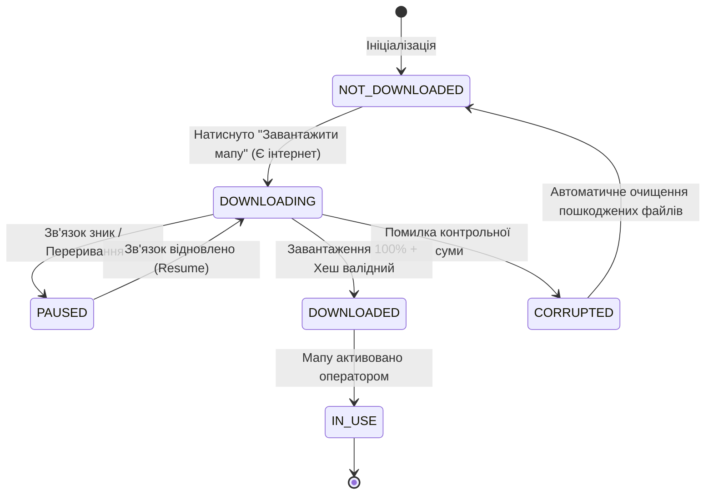

# 📱 Практичний посібник та шпаргалка кандидата: Mobile ATQC & QA Engineer

Цей воркбук містить концентровані інженерні знання, необхідні для успішного проходження технічної співбесіди та щоденної роботи на позиції **Senior / Middle+ Python Mobile ATQC (Appium 2 + Android/iOS + API + Manual QA)**.

---

## 📑 Зміст
1. [Встановлення та запуск екосистеми Appium 2.x](#1-встановлення-та-запуск-екосистеми-appium-2x)
2. [Налаштування Appium Inspector](#2-налаштування-appium-inspector)
3. [Android Emulator та золоті команди ADB](#3-android-emulator-та-золоті-команди-adb)
4. [Специфіка мобільного тестування (Field / Tactical Context)](#4-специфіка-мобільного-тестування-field--tactical-context)
5. [Техніки тест-дизайну на мобільних кейсах](#5-техніки-тест-дизайну-на-мобільних-кейсах)
6. [Еталонний мобільний баг-репорт](#6-еталонний-мобільний-баг-репорт)
7. [Чек-лист мобільного тестувальника (Mobile QA Checklist)](#7-чек-лист-мобільного-тестувальника-mobile-qa-checklist)

---

## 1. Встановлення та запуск екосистеми Appium 2.x

У версії **Appium 2.x** драйвери відокремлені від ядра сервера і встановлюються як незалежні плагіни.

### Крок 1.1: Встановлення Node.js та Appium
```bash
# Перевірка наявності Node.js (потрібна версія v18+)
node -v
npm -v

# Глобальне встановлення ядра Appium 2
npm install -g appium

# Встановлення необхідних драйверів
appium driver install uiautomator2  # Для Android
appium driver install xcuitest       # Для iOS (вимагає macOS та Xcode)

# Перевірка встановлених драйверів
appium driver list --installed
```

### Крок 1.2: Перевірка оточення через Appium Doctor
```bash
# Встановлення діагностичного інструменту
npm install -g @appium/doctor

# Перевірка змінних оточення Android (ANDROID_HOME, JAVA_HOME)
appium-doctor --android
```

### Крок 1.3: Запуск сервера Appium
```bash
# Запуск сервера на стандартному порту 4723 (з підтримкою релаксації безпеки для плагінів)
appium --relaxed-security --port 4723
```
*URL для підключення з тестів у Appium 2.x:* `http://127.0.0.1:4723` (зверніть увагу: без застарілого `/wd/hub`).

---

## 2. Налаштування Appium Inspector

Appium Inspector використовується для інспектування XML-дерева елементів (DOM), пошуку локаторів та налагодження жестів.

1. Завантажте актуальну версію з [офіційного репозиторію GitHub](https://github.com/appium/appium-inspector/releases).
2. На вкладці **Appium Server**:
   - **Remote Host**: `127.0.0.1`
   - **Remote Port**: `4723`
   - **Remote Path**: `/` (у Appium 2 шлях просто `/`, а не `/wd/hub`)
3. Вкладка **Desired Capabilities** (у форматі JSON Representation):
```json
{
  "platformName": "Android",
  "appium:automationName": "UiAutomator2",
  "appium:deviceName": "Android Emulator",
  "appium:appPackage": "com.saucelabs.mydemoapp.android",
  "appium:appActivity": ".view.activities.MainActivity",
  "appium:noReset": false,
  "appium:ensureWebviewsHavePages": true,
  "appium:newCommandTimeout": 3600
}
```

---

## 3. Android Emulator та золоті команди ADB

Утиліта `adb` (Android Debug Bridge) — це головний швейцарський ніж мобільного інженера.

### 3.1. Керування пристроями та встановлення
```bash
# Список підключених девайсів та емуляторів
adb devices -l

# Встановлення додатка з перевстановленням і збереженням кешу (-r) та дозволом даунгрейду (-d)
adb install -r -g /шлях/до/app.apk
# Флаг -g автоматично надає додатку всі runtime permissions при інсталяції!

# Видалення додатку за ім'ям пакета
adb uninstall com.saucelabs.mydemoapp.android

# Повний список встановлених пакетів сторонніх додатків (-3)
adb shell pm list packages -3
```

### 3.2. Як миттєво знайти appPackage та appActivity поточного відкритого екрана
Це одне з найчастіших питань на інтерв'ю:
```bash
# На Windows (PowerShell):
adb shell dumpsys window | Select-String -Pattern "mCurrentFocus|mFocusedApp"

# На Linux / macOS:
adb shell dumpsys window | grep -E "mCurrentFocus|mFocusedApp"

# Результат виводу:
# mCurrentFocus=Window{... u0 com.saucelabs.mydemoapp.android/com.saucelabs.mydemoapp.android.view.activities.MainActivity}
# => appPackage:  com.saucelabs.mydemoapp.android
# => appActivity: com.saucelabs.mydemoapp.android.view.activities.MainActivity
```

### 3.3. Збір та аналіз системних логів (logcat)
```bash
# Очистити буфер логів перед відтворенням багу
adb logcat -c

# Фільтрація логів лише за рівнем помилок (Errors) та критичних падінь (Fatal/Crash)
adb logcat *:E

# Фільтрація крашів додатків (AndroidRuntime / FATAL EXCEPTION)
adb logcat -v time | grep -E "AndroidRuntime|FATAL"

# Запис логів у текстовий файл для додавання до баг-репорту
adb logcat -v threadtime > bug_crash_logcat.txt
```

### 3.4. Емуляція натискань та зняття скріншотів через консоль
```bash
# Натискання в координату (X, Y)
adb shell input tap 500 1200

# Свайп/скрол від (X1, Y1) до (X2, Y2) за час у мс
adb shell input swipe 500 1500 500 400 300

# Введення тексту через емулятор клавіатури
adb shell input text "secret_password"

# Скріншот екрана та витягування файлу на ПК
adb shell screencap -p /sdcard/screen.png && adb pull /sdcard/screen.png ./screen.png
```

---

## 4. Специфіка мобільного тестування (Field / Tactical Context)

Тестування мобільних застосунків, які використовуються у польових/критичних або мілітарі-умовах (системи ситуаційної обізнаності, логістика, тактичні планшети), має унікальні вимоги до надійності:

| Напрямок тестування | Що саме перевіряється | Інженерний ризик / Наслідки |
| :--- | :--- | :--- |
| **Деградація мережі (Network Throttle)** | Робота при перемиканні WiFi ↔ 4G ↔ 2G (EDGE) ↔ No Signal, високий пінг (2000ms+), втрата 30-50% пакетів. | Зависання UI (ANR), блокування головного UI-потоку, втрата даних геопозиції. |
| **Офлайн-режим та синхронізація** | Робота з локальною БД (Room/SQLite), черга відкладених транзакцій (Outbox pattern). | Втрата зафіксованих оператором міток при переході в зону відсутності зв'язку. |
| **Переривання (Interrupts)** | Вхідний GSM/VoIP дзвінок, розряд батареї (15%, 5%), перемикання на інший додаток, пуш-сповіщення, SMS. | Скидання заповнених форм, некоректне відновлення після `onPause()` / `onResume()`. |
| **Енергоспоживання (Battery Drain)** | Активне використання GPS-чіпа у фоні, WakeLocks, утилізація CPU при рендерингу векторних мап. | Швидкий розряд пристрою в польових умовах (пристрій сідає за 1.5 години замість 8). |
| **Стрес орієнтації та форм-факторів** | Поворот екрана (Portrait ↔ Landscape), Split Screen, планшети 8"/10", робота в рукавицях. | Краш додатку через `onDestroy` Activity, обрізання кнопок підтвердження, недоступність елементів. |
| **Керування дозволами (Permissions)** | Відкликання дозволу на Геолокацію або Камеру користувачем прямо під час роботи додатка. | `SecurityException` і миттєвий краш застосунку при виклику системного API. |

---

## 5. Техніки тест-дизайну на мобільних кейсах

### 5.1. Equivalence Partitioning (EP) & Boundary Value Analysis (BVA)
**Контекст кейсу:** Поле введення дистанції до орієнтира в тактичному калькуляторі (діапазон допустимих значень: від `50` до `5000` метрів, ціле число).

| Техніка | Тестове значення | Клас еквівалентності / Точка | Очікуваний результат |
| :--- | :--- | :--- | :--- |
| **EP** | `-100` | Невалідний від'ємний клас | Помилка: "Дистанція не може бути меншою за 50 м" |
| **EP** | `1500` | Валідний робочий клас | Значення прийнято, кнопка розрахунку активна |
| **EP** | `9999` | Невалідний клас перевищення | Помилка: "Дистанція перевищує ліміт 5000 м" |
| **BVA** | `49` | Нижче нижньої межі (Lower - 1) | Помилка валідації |
| **BVA** | `50` | Нижня межа (Min) | Валідно, розрахунок дозволено |
| **BVA** | `51` | Вище нижньої межі (Min + 1) | Валідно |
| **BVA** | `4999` | Нижче верхньої межі (Max - 1) | Валідно |
| **BVA** | `5000` | Верхня межа (Max) | Валідно |
| **BVA** | `5001` | Вище верхньої межі (Max + 1) | Помилка валідації |

### 5.2. Decision Table (Таблиця прийняття рішень)
**Контекст кейсу:** Дозвіл на відправку екстреного звіту (SOS Beacon).  
Умови:
1. Наявність фіксації GPS координат (True/False).
2. Залишок заряду батареї > 10% (True/False).
3. Наявність будь-якого зв'язку (Мережа або Радіомодем) (True/False).

| Умови (Conditions) | Правило 1 | Правило 2 | Правило 3 | Правило 4 |
| :--- | :---: | :---: | :---: | :---: |
| GPS координати зафіксовані | **True** | **True** | **False** | **True** |
| Заряд батареї > 10% | **True** | **True** | **True** | **False** |
| Зв'язок є (Мережа / Модем) | **True** | **False** | **True** | **True** |
| **Дія: Відправити негайно** | ✅ **ТАК** | ❌ НІ | ❌ НІ | ❌ НІ |
| **Дія: Зберегти в локальну чергу (Outbox)** | ❌ НІ | ✅ **ТАК** | ❌ НІ | ❌ НІ |
| **Дія: Сповіщення "Немає координат"** | ❌ НІ | ❌ НІ | ✅ **ТАК** | ❌ НІ |
| **Дія: Перевести модем в Low Power Mode** | ❌ НІ | ❌ НІ | ❌ НІ | ✅ **ТАК** |

### 5.3. State Transition Testing (Діаграма переходів станів)
**Контекст кейсу:** Синхронізація офлайн-пакетів топографічних карт.



---

## 6. Еталонний мобільний баг-репорт

Якісний мобільний баг-репорт повинен містити всю апаратну специфіку, щоб розробник міг відтворити його за 5 хвилин без додаткових запитань.

```markdown
**Title:** [Android 14][Crash] Додаток аварійно завершує роботу (FATAL EXCEPTION) 
при зміні орієнтації екрана з Portrait на Landscape на формі створення місії

**Severity:** Critical
**Priority:** High
**Component:** Mission Planning / UI Lifecycle

**Environment & Device:**
- Device: Samsung Galaxy Tab Active4 Pro (SM-T636B) / Android Emulator Pixel 6
- OS Version: Android 14 (OneUI 6.0, API Level 34)
- App Build: v2.4.1 (Build 1420)
- Network: Offline (Airplane mode)

**Preconditions:**
1. Користувач авторизований під роллю `operator`.
2. Відкрито екран: "Нова тактична задача".
3. У полі "Назва завдання" введено: `Операція Омега`.

**Steps to Reproduce:**
1. Натиснути кнопку "Додати координати цілі".
2. Ввести значення `50.4501, 30.5234`.
3. Повернути планшет на 90 градусів (змінити орієнтацію екрана з Portrait на Landscape).

**Expected Result:**
Орієнтація екрана змінюється на Landscape, введені назва місії та координати зберігаються 
(стан форми відновлено з savedInstanceState), додаток продовжує стабільну роботу.

**Actual Result:**
Екран блимає чорним, з'являється системний діалог "Застосунок зупинено", додаток крашиться. 
У системному журналі logcat фіксується `NullPointerException` у `MissionCreateActivity.onRestoreInstanceState`.

**Logcat Snippet:**
FATAL EXCEPTION: main
Process: com.tactical.fieldapp, PID: 18492
java.lang.NullPointerException: Attempt to invoke virtual method 'double com.tactical.fieldapp.models.GeoPoint.getLat()' on a null object reference
    at com.tactical.fieldapp.ui.MissionCreateActivity.onRestoreInstanceState(MissionCreateActivity.kt:142)
    at android.app.Activity.performRestoreInstanceState(Activity.java:1602)

**Attachments:**
- 📎 `crash_orientation_video.mp4` (відеозапис екрана)
- 📎 `logcat_dump_20261106.txt` (повний лог adb)
- 📎 `layout_hierarchy.xml` (знімок DOM дерева в момент падіння)
```

---

## 7. Чек-лист мобільного тестувальника (Mobile QA Checklist)

Використовуйте цей чек-лист перед кожним релізом:

- [ ] **1. Інсталяція та оновлення:**
  - [ ] Чиста інсталяція (`fresh install`) на підтримувані версії ОС (Android 11–15, iOS 16–18).
  - [ ] Оновлення поверх попередньої мажорної версії (`update over old build`) зі збереженням сесії та локальної БД.
  - [ ] Видалення (`uninstall`) та перевірка відсутності залишкових файлів у відкритій пам'яті.
- [ ] **2. Життєвий цикл та переривання:**
  - [ ] Згортання у фон (`Home button` / `background_app`) на 10 сек, 5 хв, 30 хв.
  - [ ] Вхідний дзвінок GSM під час критичної дії (оплата, збереження звіту).
  - [ ] Пуш-сповіщення від іншого додатка під час введення даних.
  - [ ] Спрацювання системного будильника.
  - [ ] Поява системного попапу "Батарея розряджена (20%)".
- [ ] **3. Мережева стійкість:**
  - [ ] Повний офлайн (Airplane Mode) — жодного блокування інтерфейсу, відображення дружнього статусу.
  - [ ] Повільна мережа (3G / 100kbps, High Latency) — наявність Skeleton Screens або спінерів завантаження.
  - [ ] Перемикання "на льоту": початок дії на Wi-Fi, вимкнення роутера -> автоматичний перехід на 4G без втрати запиту.
- [ ] **4. Екран та адаптивність:**
  - [ ] Поворот Portrait ↔ Landscape на всіх ключових екранах (збереження даних форм).
  - [ ] Коректність відображення на екранах з вирізами (Notch / Dynamic Island / камера).
  - [ ] Збільшений системний шрифт (Accessibility Display Scale 130%-150%) — тексти не налізають один на одного.
  - [ ] Робота з віртуальною клавіатурою: клавіатура не перекриває поле вводу та кнопку "Підтвердити".
- [ ] **5. Безпека та системні дозволи:**
  - [ ] Дозволи запитуються в контексті дії (Just-in-time), а не всі одразу при першому запуску.
  - [ ] Відхилення дозволу ("Deny"): додаток показує зрозуміле пояснення і не крашиться.
  - [ ] Перевірка безпеки: відсутність паролів і токенів у логах `adb logcat`.
